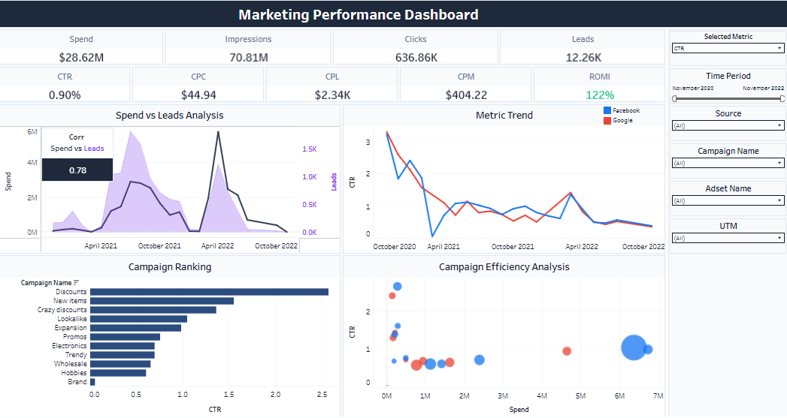
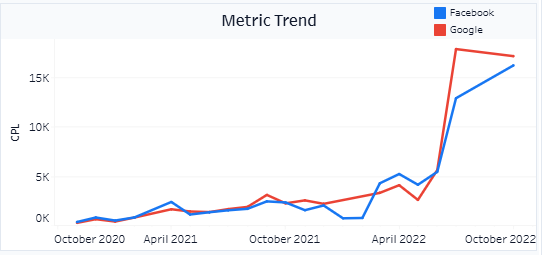
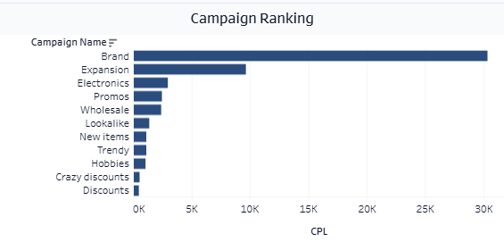
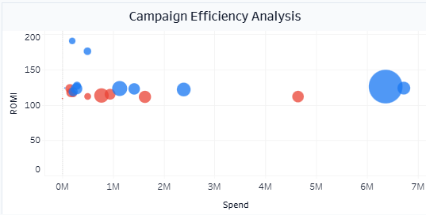
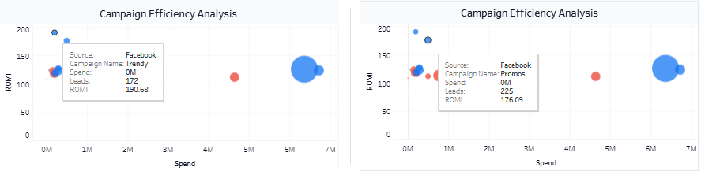

# Marketing Performance Dashboard

**SQL · PostgreSQL · DBeaver · Tableau Public**

An interactive marketing dashboard built on advertising data from Facebook Ads and Google Ads. Data from four database tables is joined and cleaned in SQL, exported to CSV, and turned into a Tableau dashboard that tracks spend, leads and efficiency of ad campaigns.

🔗 **[Open the interactive dashboard on Tableau Public](https://public.tableau.com/views/MarketingPerformanceDashboardFacebookAdsGoogleAds/MarketingPerformance?:language=en-US&:sid=&:redirect=auth&:display_count=n&:origin=viz_share_link)**

> Training project (course dataset).



---

## 🎯 Goal

Help a marketing team see which ad campaigns and channels work, and where the budget is wasted:

- How much is spent, and how many leads does it bring?
- Is it true that a bigger budget brings more leads?
- Which campaigns and which platform (Facebook or Google) are the most efficient?
- How do costs change over time?

---

## 🗂 Data

Four tables in a PostgreSQL database:

| Table | Role | Content |
|---|---|---|
| `facebook_ads_basic_daily` | Fact | Daily Facebook data: spend, impressions, reach, clicks, leads, value, URL with UTM tags |
| `facebook_campaign` | Lookup | Campaign ID → campaign name |
| `facebook_adset` | Lookup | Ad set ID → ad set (audience segment) name |
| `google_ads_basic_daily` | Fact | Daily Google data, with campaign and ad set names already in text |

---

## 🔧 Approach

### 1. SQL: one dataset for Tableau (DBeaver)
1. Explored the four tables: facts vs. lookups, column names, data types, join keys
2. Joined the Facebook table with the campaign and ad set lookups, replacing technical IDs with readable names
3. Added a `source` field (Facebook / Google) and combined both platforms with `UNION ALL`
4. Wrote a custom function to **decode URL parameters** and extracted `utm_campaign`
5. Replaced empty values with `COALESCE`
6. Aggregated spend, impressions, reach, clicks, leads and value by date, source, campaign, ad set and UTM campaign
7. Exported the result to CSV and loaded it into Tableau Public

Final query: [`sql/fb_google_ads.sql`](sql/fb_google_ads.sql)

### 2. Tableau: calculated fields and parameter
- **Metrics:** CTR, CPC, CPM, CPL, ROMI (value ÷ spend; in this dataset value is net profit), Clicks to Leads Conversion, Reach to Leads Conversion
- **LOD calculations:** `monthly_spend` and `monthly_leads` with `FIXED`
- **Correlation:** `corr leads spend`, correlation between monthly spend and leads
- **Parameter `Select Metric`** with the calculated field `Selected Metric`, so the same charts can switch between CTR, CPC, CPL, ROMI and both conversion rates

### 3. Dashboard
| Block | Content |
|---|---|
| **KPI cards** | Spend, Impressions, Clicks, Leads, CTR, CPC, CPL, CPM, ROMI |
| **Spend vs Leads Analysis** | Dual-axis chart by month, with the correlation value placed on top |
| **Metric Trend** | Line chart of the selected metric over time, Facebook vs. Google |
| **Campaign Ranking** | Bar chart of campaigns sorted by the selected metric |
| **Campaign Efficiency Analysis** | Scatter plot: one point per campaign, colored by platform, sized by leads |
| **Interactivity** | Filter action: click a campaign point to filter the trend and spend charts. Filters for date range, source, campaign, ad set and UTM campaign |

---

## 📈 Results

### Key findings

- **Campaigns pay off.** ROMI is **122%** on a total spend of **$28.62M** and **12.26K** leads.
- **Spend and leads move together.** The correlation between monthly spend and leads is **0.78**.
- **Costs grew fast.** Average CPC is **$44.94** and CPL **$2.34K**, but by the end of 2022 CPC rose above **$500** and CPL above **$16K**.
- **Weakest campaigns: "Brand" and "Expansion".** They have the highest CPL (about **$9.5K–$30K**) and low CTR: below 0.1% for "Brand" and below 1% for "Expansion".
- **Strongest campaigns.** "Discounts" has the lowest CPL and the highest CTR (about 2.5%). "Trendy" (ROMI 191%) and "Promos" (ROMI 176%) have the highest return, both on Facebook.
- **Google converts clicks to leads better** than Facebook.

### Recommendations

1. **Move budget to what works.** Shift money from expensive, low-performing campaigns ("Brand", "Expansion") to high-converting ones ("Discounts", "Trendy", "Promos").
2. **Stop the cost growth.** Review targeting and refresh creatives to slow down the rise of CPC and CPL.
3. **Scale the best campaigns step by step.** The highest ROMI ("Trendy", "Promos") comes from small budgets, so check that it holds as spend grows.
4. **Use different offers for Google and Facebook,** because Google converts clicks into leads better.

---

## 🖼 Screenshots

The `Select Metric` parameter switches the same charts between metrics. Examples with **CPL** and **ROMI**:

**Metric Trend, CPL by platform**<br>


**Campaign Ranking, CPL**<br>


**Campaign Efficiency Analysis, ROMI**<br>


**Highest ROMI: "Trendy" and "Promos" (Facebook)**<br>


---

## 🛠 Skills demonstrated

| Area | Skills |
|---|---|
| **SQL** | Joins, `UNION ALL`, CTEs, `COALESCE`, `NULLIF`, regular expressions, custom function for URL decoding, aggregation |
| **Tableau** | Calculated fields, `FIXED` LOD, parameters, dual-axis, scatter plot, dashboard actions, filters |
| **Marketing analytics** | CTR, CPC, CPM, CPL, ROMI, conversion funnel, correlation between budget and leads |
| **Business thinking** | Campaign comparison, budget allocation recommendations |

---

## 📁 Repository structure

```
marketing-dashboard-tableau/
├── README.md
├── sql/
│   └── fb_google_ads.sql
└── images/
    ├── dashboard.png
    ├── metric-trend-cpl.png
    ├── campaign-ranking-cpl.png
    ├── campaign-efficiency-romi.png
    └── campaign-efficiency-roi-tooltip.png
```
